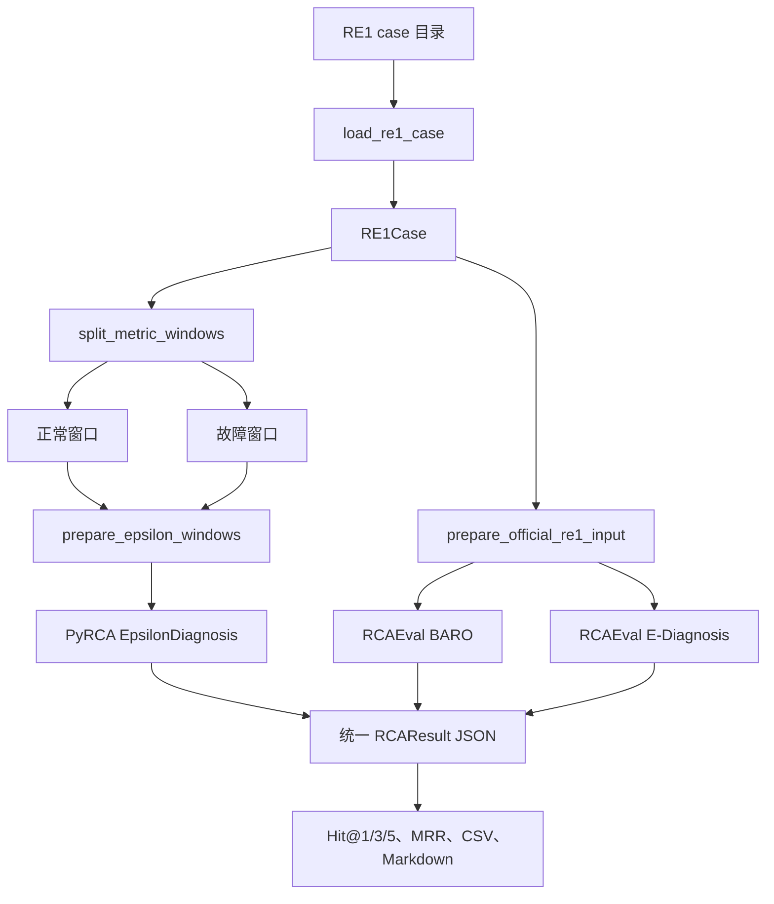

# RCA_Time：RE1 时序指标根因分析学习项目

这是一个面向初学者和协作学习者的 Windows 根因分析（Root Cause Analysis，RCA）项目。
项目使用 RE1 指标数据、PyRCA EpsilonDiagnosis 和 RCAEval 1.2.0 中的 BARO、
E-Diagnosis，完成从故障案例读取到根因排序与评价报告生成的完整实验闭环。

> 当前边界：RE1 已经提供故障注入时间 `inject_time`。本项目使用它切分正常窗口与故障窗口，
> 尚未实现从连续在线数据中自动发现异常时间点。因此更准确的状态是：
> **时序数据处理已完成、已知异常窗口上的根因定位已完成、在线时序异常检测待实现。**

## 1. 项目在完整链路中的位置

计划中的长期流程是：


当前完成情况：

| 阶段 | 状态 | 本项目现在做了什么 | 仍缺少什么 |
|---|---|---|---|
| 时序数据 | 已完成 | 下载、读取、验证 RE1；支持 CSV/JSON；识别服务、故障类型和注入时间 | 生产监控系统的实时采集 |
| 时序异常检测 | 部分完成 | 使用数据集给出的 `inject_time` 划分正常/异常窗口 | 从未知连续流中自动检测异常并产生异常时间戳 |
| 根因定位 | 已完成学习闭环 | PyRCA EpsilonDiagnosis、RCAEval BARO/E-Diagnosis、统一 JSON、Hit@K/MRR | 更多算法、更多案例、因果图和线上验证 |
| RAG 检索 | 未开始 | 已有结构化 RCA JSON，可作为未来知识条目的一部分 | 文档切分、向量化、检索、重排、回答与引用 |
| 日志/工单 | 未开始 | 暂无 | 采集、脱敏、结构化、与 RCA 结果关联 |

下一阶段不是直接把原始时序表格全部塞进 RAG。更合适的做法是先把每次 RCA 结果转为
“故障服务、故障指标、时间、Top-K 根因、图表、处置过程、最终结论”的事件文档，再和日志、
运行手册、历史工单一起建立可检索知识库。

## 2. 已实现的实验流程



默认批量实验使用 RE1-OB 中 5 个服务的 delay/loss 实例 1：

- `adservice`
- `cartservice`
- `checkoutservice`
- `currencyservice`
- `productcatalogservice`

共 10 个案例 × 3 种方法 = 30 次算法运行。

## 3. 目录结构

```text
RCA/
├─ configs/
│  └─ experiment.yaml          # 早期实验配置草案，目前脚本尚未读取此文件
├─ data/
│  ├─ RE1/                     # RE1-OB/SS/TT 数据，不提交 Git
│  ├─ raw/                     # 原始数据占位目录
│  └─ processed/               # 预处理数据占位目录
├─ docs/
│  └─ 11_batch_experiment.md   # 第 11 步批量实验学习说明
├─ models/                     # 未来保存模型/图结构，当前为空
├─ outputs/
│  ├─ figures/                 # 案例时序图，不提交 Git
│  ├─ predictions/             # 单次算法统一 JSON，不提交 Git
│  └─ reports/                 # CSV/Markdown/Excel 报告，不提交 Git
├─ scripts/
│  ├─ download_re1.py          # 下载并安全解压 RE1
│  ├─ inspect_re1.py           # 检查单个案例
│  ├─ learn_window_split.py    # 用合成数据学习窗口切分
│  ├─ learn_epsilon_diagnosis.py # 用合成数据学习 EpsilonDiagnosis
│  ├─ visualize_case.py        # 绘制真实案例正常/异常时序
│  ├─ run_pyrca.py             # 运行项目版 PyRCA EpsilonDiagnosis
│  ├─ run_rcaeval.py           # 运行固定版本 RCAEval BARO/E-Diagnosis
│  ├─ run_batch.py             # 自动运行 10 案例 × 3 方法
│  └─ evaluate_results.py      # 读取统一 JSON 并生成评价报告
├─ src/
│  ├─ case_analysis.py         # 与算法无关的指标变化排序
│  ├─ data_loader.py           # RE1 案例读取、解析与校验
│  ├─ metrics.py               # Hit@K、MRR、服务级排名
│  ├─ preprocessing.py         # PyRCA 窗口清洗
│  ├─ result_schema.py         # 统一结果数据类
│  └─ window_splitter.py       # 按 inject_time 切分窗口
├─ tests/
│  ├─ fixtures/                # 可提交的小型测试案例
│  └─ test_*.py                # unittest 自动化测试
├─ vendor/RCAEval/             # 固定的 RCAEval 1.2.0 源码，不提交 Git
├─ model.py                    # RE1Case 的旧入口兼容导出
├─ sample.ipynb                # 最小 PyRCA 调用片段
├─ pyproject.toml              # 本项目包元数据
├─ requirements.txt            # 环境策略说明，不会自动安装依赖
└─ .gitignore                  # 排除环境、密钥、数据、依赖源码和输出
```

## 4. Windows 运行环境

本项目当前只在已有 Conda 环境 `fastapi_env` 中验证：

```powershell
conda activate fastapi_env
python --version
where.exe python
```

已验证解释器：

```text
Python 3.12.13
D:\miniconda\envs\fastapi_env\python.exe
```

关键包版本：

| 包 | 已测试版本 |
|---|---:|
| sfr-pyrca | 1.0.1 |
| numpy | 2.5.1 |
| pandas | 3.0.3 |
| scipy | 1.18.0 |
| scikit-learn | 1.9.0 |
| networkx | 3.6.1 |
| matplotlib | 3.11.1 |


```powershell
python -m pip check
python -c "import numpy,pandas,scipy,sklearn,networkx,matplotlib; print('core imports ok')"
python -c "from pyrca.analyzers.epsilon_diagnosis import EpsilonDiagnosis; print('PyRCA import ok')"
```

## 5. 准备 RCAEval 固定源码

本项目没有安装完整 RCAEval 依赖，而是从固定源码加载本实验所需的最小模块。
`vendor/RCAEval/` 被 Git 忽略，克隆仓库后需要在项目根目录执行：

```powershell
git clone --branch 1.2.0 --depth 1 https://github.com/phamquiluan/RCAEval.git vendor/RCAEval
git -C vendor/RCAEval rev-parse HEAD
```

期望提交：

```text
bc49dbd85bd14032101fb9a69a5a37e9d6d55178
```

`scripts/run_rcaeval.py` 会校验关键源码文件是否存在，并在结果元数据中记录版本和提交号。

## 6. 准备 RE1 数据

查看数据状态，不下载：

```powershell
python -m scripts.download_re1
```

只下载 Online Boutique：

```powershell
python -m scripts.download_re1 --systems ob --download
```

下载全部 RE1-OB、RE1-SS、RE1-TT：

```powershell
python -m scripts.download_re1 --systems all --download
```

数据默认位于 `data/RE1/`，下载压缩包暂存在 `data/.downloads/`。脚本会执行 MD5 校验，
并在解压前检查 ZIP 路径，防止文件逃逸到目标目录之外。

## 7. 推荐学习顺序与完整命令

所有命令都应在 `D:\Project\RCA` 根目录运行，并使用 `python -m scripts.xxx`。
`-m` 表示按模块启动，可以让 Python 正确找到同级的 `src` 和 `scripts` 包。

### 7.1 学习窗口切分

```powershell
python -m scripts.learn_window_split
```

观察一个连续时序如何以 `inject_time` 为边界，切成等长正常窗口和异常窗口。

### 7.2 学习 EpsilonDiagnosis

```powershell
python -m scripts.learn_epsilon_diagnosis --fault-metric checkout_latency
python -m scripts.learn_epsilon_diagnosis --fault-metric cart_cpu
python -m scripts.learn_epsilon_diagnosis --fault-metric payment_memory
```

这一步只使用可控的合成数据，便于理解 `train(normal_data)` 和
`find_root_causes(abnormal_data)` 的输入输出。

### 7.3 检查真实案例

```powershell
python -m scripts.inspect_re1 data/RE1/RE1-OB/adservice_loss/1
```

输出案例 ID、系统、服务、故障类型、注入时间、指标数量、时间范围和采样间隔。

### 7.4 绘制真实案例

```powershell
python -m scripts.visualize_case data/RE1/RE1-OB/adservice_loss/1 --window-minutes 5 --top-k 5
```

默认图像保存到 `outputs/figures/adservice_loss_1.png`。

### 7.5 运行单案例 PyRCA

```powershell
python -m scripts.run_pyrca `
  --case-path data/RE1/RE1-OB/adservice_loss/1 `
  --window-minutes 5 `
  --alpha 0.05 `
  --bootstrap-time 50 `
  --top-k 20
```

### 7.6 运行单案例 RCAEval

```powershell
python -m scripts.run_rcaeval `
  --case-path data/RE1/RE1-OB/adservice_loss/1 `
  --methods baro e_diagnosis `
  --top-k 20
```

### 7.7 批量运行 10 个案例

```powershell
python -m scripts.run_batch
```

只运行 BARO：

```powershell
python -m scripts.run_batch --methods baro
```

只重新生成评价报告，不重新运行算法：

```powershell
python -m scripts.evaluate_results
```

## 8. 核心类总结

### `src.data_loader.RE1Case`

一个 RE1 故障案例的领域对象，由 `load_re1_case()` 返回。

| 字段 | 类型 | 含义 |
|---|---|---|
| `case_id` | `str` | 例如 `adservice_loss_1` |
| `system` | `str` | `online-boutique`、`sock-shop` 或 `train-ticket` |
| `service` | `str` | 注入故障的服务 |
| `fault_type` | `str` | cpu/mem/disk/delay/loss |
| `instance_id` | `str` | 重复实验编号 |
| `inject_time` | `int` | Unix 故障注入时间 |
| `metrics` | `pandas.DataFrame` | `time` 加所有指标列 |
| `root_cause_service` | `str` | 服务级标准答案 |
| `root_cause_metric` | `str | None` | 能唯一推断时的指标级答案 |

调用：

```python
from src.data_loader import load_re1_case

case = load_re1_case("data/RE1/RE1-OB/adservice_loss/1")
print(case.service, case.fault_type, case.inject_time)
print(case.metrics.shape)
```

### `src.window_splitter.MetricWindows`

保存两个列完全一致、行数相等的 DataFrame：

- `normal`：`[inject_time - window, inject_time)`
- `abnormal`：`[inject_time, inject_time + window)`

```python
from src.window_splitter import split_metric_windows

windows = split_metric_windows(case.metrics, case.inject_time, window_minutes=5)
```

### `src.preprocessing.PreprocessingReport`

记录 PyRCA 预处理前后指标数，以及因为非数值、非有限值、正常窗口常量、异常窗口常量而删除的列。
调用 `report.to_dict()` 可直接放进 JSON 元数据。

### `src.result_schema.RankedRootCause`

单个根因候选：`rank` 从 1 开始，`metric` 是指标名，`score` 可以为空。

### `src.result_schema.GroundTruth`

基准答案：`service` 必填，`metric` 可以为空。

### `src.result_schema.RCAResult`

统一承载所有算法结果。构造时检查文本字段、耗时和连续排名；`to_dict()` 返回可序列化字典。

```python
from src.result_schema import GroundTruth, RCAResult, RankedRootCause

result = RCAResult(
    incident_id="demo-1",
    system="online-boutique",
    fault_type="delay",
    inject_time=0,
    method="demo",
    root_causes=[RankedRootCause(rank=1, metric="adservice_latency", score=0.9)],
    ground_truth=GroundTruth(service="adservice", metric="adservice_latency"),
    runtime_seconds=0.01,
)
payload = result.to_dict()
```

### `scripts.download_re1.ArchiveSpec`

保存数据压缩包名称、解压目录、官方 URL、预期大小和 MD5。`ARCHIVES` 中有 OB/SS/TT 三个实例。

## 9. 每个源码文件与函数说明

下列以 `_` 开头的函数是模块内部实现。学习时可以阅读，但跨模块调用优先使用不带 `_` 的公开函数。

### `src/case_analysis.py`

| 函数 | 输入 | 输出 | 功能 |
|---|---|---|---|
| `rank_metric_changes(normal, abnormal)` | 两个同列 DataFrame | 排序后的 DataFrame | 用绝对均值变化除以合并标准差，得到跨量纲探索分数；不是因果概率 |

### `src/data_loader.py`

| 函数 | 功能 |
|---|---|
| `_parse_case_name(case_path)` | 同时解析旧式 `<service>_<fault>/<instance>` 和新式扁平目录名 |
| `_infer_system(case_path)` | 从路径推断 OB/SS/TT 对应系统名 |
| `_read_metrics_json(metrics_path)` | 支持 records、columns、pandas split 和 JSON Lines |
| `_read_metrics(case_path)` | 按顺序寻找 `metrics.json`、`data.csv`、`simple_data.csv` |
| `_validate_metrics(metrics)` | 检查非空、`time`、数值、缺失值、重复时间并排序 |
| `_infer_root_cause_metric(columns, service, fault_type)` | 根据服务和故障类型尝试推断标准指标名 |
| `load_re1_case(case_path)` | 完成全部读取和验证，返回 `RE1Case` |

### `src/window_splitter.py`

| 函数 | 功能 |
|---|---|
| `split_metric_windows(data, inject_time, window_minutes, minimum_points=2)` | 按注入时间切分等长窗口，删除 `time` 列并校验点数、列、类型 |

### `src/preprocessing.py`

| 函数 | 功能 |
|---|---|
| `PreprocessingReport.to_dict()` | 把预处理报告转为普通字典 |
| `prepare_epsilon_windows(normal, abnormal)` | 删除 EpsilonDiagnosis 无法可靠比较的列，返回两个干净窗口和报告 |

### `src/case_analysis.py`

```python
from src.case_analysis import rank_metric_changes

ranking = rank_metric_changes(windows.normal, windows.abnormal)
print(ranking.head(5))
```

### `src/metrics.py`

| 函数 | 功能 |
|---|---|
| `_normalize(name)` | 去空格并转小写 |
| `hit_at_k(predictions, target, k)` | 指标级标准答案是否在前 K 名 |
| `reciprocal_rank(predictions, target)` | 首次指标命中的 `1/rank`，未命中为 0 |
| `mean(values)` | 求均值；空输入返回 `None` |
| `service_rank(predictions, target_service)` | 返回目标服务第一次出现的排名 |
| `service_hit_at_k(predictions, target_service, k)` | 服务第一次出现的位置是否不大于 K |

```python
from src.metrics import hit_at_k, reciprocal_rank, service_hit_at_k

predictions = ["cartservice_cpu", "adservice_latency"]
print(hit_at_k(predictions, "adservice_latency", 3))
print(reciprocal_rank(predictions, "adservice_latency"))
print(service_hit_at_k(predictions, "adservice", 3))
```

### `src/result_schema.py`

| 类/方法 | 功能 |
|---|---|
| `RankedRootCause.__post_init__()` | 校验排名从 1 开始且指标名非空 |
| `GroundTruth.__post_init__()` | 校验服务标准答案非空 |
| `RCAResult.__post_init__()` | 校验必要字段、非负耗时和连续排名 |
| `RCAResult.to_dict()` | 转为 JSON 兼容字典 |

### `scripts/download_re1.py`

| 函数 | 功能 |
|---|---|
| `md5_file(path)` | 分块计算文件 MD5 |
| `download_file(spec, archive_path)` | 下载到 `.part`，显示进度，完成后原子改名 |
| `safe_extract(archive_path, destination)` | 拒绝 ZIP 路径穿越后解压 |
| `install_archive(spec, target_dir, download_dir)` | 下载、校验、临时解压并移动到目标目录 |
| `parse_args()` | 定义 `--systems`、`--target`、`--download-dir`、`--download` |
| `main()` | 显示数据状态，按需执行安装 |

### `scripts/inspect_re1.py`

| 函数 | 功能 |
|---|---|
| `parse_args()` | 接收可选案例目录 |
| `main()` | 调用加载器并打印案例摘要、采样间隔、前三行 |

### `scripts/learn_window_split.py`

| 函数 | 功能 |
|---|---|
| `build_continuous_incident()` | 构造 20 分钟合成时序，在第 10 分钟注入延迟 |
| `main()` | 切分并打印窗口形状和均值 |

### `scripts/learn_epsilon_diagnosis.py`

| 函数 | 功能 |
|---|---|
| `build_demo_data(fault_metric, num_points=120)` | 生成等长正常/异常窗口并注入一个可选指标故障 |
| `parse_args()` | 定义 `--fault-metric` |
| `main()` | 展示输入、均值、阈值、相关分数和 PyRCA 结果 |

### `scripts/visualize_case.py`

| 函数 | 功能 |
|---|---|
| `normalize_for_plot(series, normal_values)` | 把每条曲线缩放到 0–1，仅用于显示 |
| `plot_case(case, windows, ranking, window_minutes, top_k, output_path)` | 绘制故障服务指标和变化最大的指标 |
| `parse_args()` | 定义案例路径、窗口长度、Top-K 和输出路径 |
| `main()` | 加载、切窗、排序、画图并打印摘要 |

### `scripts/run_pyrca.py`

| 函数 | 功能 |
|---|---|
| `validate_metric_windows(normal_data, abnormal_data)` | 在调用 PyRCA 前检查空值、列顺序、等长、列数和数值类型 |
| `run_epsilon_diagnosis(...)` | 固定随机种子，训练正常窗口，分析异常窗口，返回统一 `RCAResult` |
| `save_result(result, output_path)` | 保存 UTF-8 JSON |
| `parse_args()` | 定义 demo/真实案例、窗口、alpha、bootstrap、Top-K、输出路径 |
| `main()` | 串联加载、切窗、预处理、算法、评价和保存 |

直接在 Python 中调用算法适配器：

```python
from scripts.run_pyrca import run_epsilon_diagnosis

result = run_epsilon_diagnosis(
    normal_data,
    abnormal_data,
    incident_id="case-1",
    system="online-boutique",
    fault_type="delay",
    inject_time=0,
    ground_truth_service="adservice",
    ground_truth_metric="adservice_latency",
    root_cause_top_k=5,
)
```

### `scripts/run_rcaeval.py`

| 函数 | 功能 |
|---|---|
| `_activate_pinned_source()` | 校验并加入固定 RCAEval 源码目录 |
| `load_official_baro()` | 只加载官方 `baro.py`，绕开无关可选依赖 |
| `load_official_preprocess()` | 加载官方时间序列预处理函数 |
| `official_fault_indicator(case)` | delay/loss→latency，disk→diskio，组成指标标准答案 |
| `prepare_official_re1_input(case, points_per_window=300)` | 对齐 RCAEval 1.2.0：去 latency-50、补值、取 300+300 点、重命名 latency-90 |
| `_build_result(...)` | 把 RCAEval 排名包装成统一 `RCAResult` |
| `run_baro(case, data, top_k)` | 运行官方 BARO 并截取 Top-K |
| `run_e_diagnosis(case, data)` | 按官方 alpha=0.01 运行 E-Diagnosis |
| `save_result(result, output_dir)` | 根据案例和方法生成 JSON 文件名 |
| `print_evaluation(result)` | 打印 Top 预测、服务排名、Hit@1/3/5 和耗时 |
| `parse_args()` / `main()` | 单案例命令入口 |

```python
from scripts.run_rcaeval import prepare_official_re1_input, run_baro

official_data = prepare_official_re1_input(case)
result = run_baro(case, official_data, top_k=20)
```

### `scripts/run_batch.py`

| 函数 | 功能 |
|---|---|
| `discover_cases(dataset_root, fault_types, instance_id)` | 找出同时具有所选故障类型的服务案例 |
| `run_pyrca_case(case, top_k)` | 用固定 5 分钟窗口和项目参数运行 PyRCA |
| `_save_payload(payload, output_path)` | 保存统一结果或错误记录 |
| `run_batch(case_paths, methods, output_dir, top_k)` | 逐案例逐算法运行，单次失败不会中断整个批次 |
| `parse_args()` | 定义数据根目录、实例、故障类型、方法、Top-K 和输出目录 |
| `main()` | 自动发现案例、运行算法并生成报告 |

### `scripts/evaluate_results.py`

| 函数 | 功能 |
|---|---|
| `canonical_metric(metric)` | 把 `latency-90` 归一为 RCAEval 的 `latency` 标签 |
| `metric_rank(predictions, target)` | 返回指标级首次匹配排名 |
| `_hit(rank, k)` | 把排名转换为 Hit@K |
| `result_to_row(payload)` | 把统一 JSON 或错误 JSON 展平为逐案例记录 |
| `summarize(rows)` | 按方法求成功数、Hit@K、MRR 和平均耗时 |
| `_write_csv(...)` | 使用 Windows/Excel 兼容 UTF-8 BOM 写 CSV |
| `_format_score(value)` | 报告中保留三位小数 |
| `_write_markdown(...)` | 生成中文 Markdown 汇总 |
| `evaluate_directory(input_dir, output_dir)` | 扫描 JSON，输出明细 CSV、汇总 CSV 和 Markdown |
| `parse_args()` / `main()` | 独立重算报告的命令入口 |

## 10. 输出 JSON 结构

每次成功运行统一为：

```json
{
  "incident_id": "adservice_loss_1",
  "system": "online-boutique",
  "fault_type": "loss",
  "inject_time": 1690000000,
  "method": "rcaeval_baro",
  "root_causes": [
    {"rank": 1, "metric": "adservice_latency", "score": null}
  ],
  "ground_truth": {
    "service": "adservice",
    "metric": "adservice_latency"
  },
  "runtime_seconds": 0.03,
  "metadata": {}
}
```

批量运行发生异常时会写入 `status: "error"` 的错误记录，报告会把失败运行的准确率按 0 计入，
但不会让整个实验中止。

## 11. 评价指标

- **指标 Hit@K**：标准指标是否在预测前 K 名。
- **服务 Hit@K**：前 K 个预测指标中是否有属于标准服务的指标。
- **MRR**：第一次正确命中的排名倒数；第 1 名为 1，第 2 名为 0.5，未命中为 0。
- **Runtime**：算法核心训练与推断耗时；它不是严格性能基准，因为没有执行预热和多次重复。

服务级和指标级不能混用。例如标准答案是 `adservice_latency`，预测第一名为
`adservice_mem`：服务 Hit@1=1，但指标 Hit@1=0。

当前 10 案例结果：

| 方法 | 服务 Hit@1 | 服务 Hit@3 | 服务 Hit@5 | 指标 Hit@1 | 指标 Hit@3 |
|---|---:|---:|---:|---:|---:|
| PyRCA EpsilonDiagnosis | 0.10 | 0.30 | 0.30 | 0.00 | 0.00 |
| RCAEval BARO | 0.50 | 0.70 | 1.00 | 0.50 | 0.70 |
| RCAEval E-Diagnosis | 0.10 | 0.20 | 0.20 | 0.00 | 0.00 |

样本仅 10 个，结果用于学习代码和评价流程，不代表算法在所有数据集上的普遍性能。

## 12. 完整测试方法

### 12.1 一键运行全部测试

```powershell
cd D:\Project\RCA
conda activate fastapi_env
python -m unittest discover -s tests -v
```

当前期望：18 个测试通过。

### 12.2 按模块运行测试

```powershell
python -m unittest tests.test_data_loader -v
python -m unittest tests.test_window_splitter -v
python -m unittest tests.test_preprocessing -v
python -m unittest tests.test_case_analysis -v
python -m unittest tests.test_metrics -v
python -m unittest tests.test_result_schema -v
python -m unittest tests.test_run_pyrca -v
python -m unittest tests.test_run_rcaeval -v
python -m unittest tests.test_evaluate_results -v
```

### 12.3 每个测试文件覆盖什么

| 测试文件 | 覆盖内容 |
|---|---|
| `test_data_loader.py` | 小型 RE1 fixture 加载、路径标签、缺失目录错误 |
| `test_window_splitter.py` | 窗口边界、等长切分、重复时间戳拒绝 |
| `test_preprocessing.py` | 常量列和非有限值删除 |
| `test_case_analysis.py` | 变化指标应排在稳定指标之前 |
| `test_metrics.py` | Hit@K、RR、均值、服务级排名 |
| `test_result_schema.py` | JSON 可序列化与连续排名约束 |
| `test_run_pyrca.py` | 合成故障排名与输入校验 |
| `test_run_rcaeval.py` | 真实 RE1 官方预处理形状和 latency 命名 |
| `test_evaluate_results.py` | latency-90 归一化、服务/指标排名、错误计零 |

`test_run_rcaeval.py` 在真实数据不存在时会跳过对应测试，这是 unittest 的预期行为。

### 12.4 端到端测试

```powershell
python -m scripts.inspect_re1 data/RE1/RE1-OB/adservice_delay/1
python -m scripts.visualize_case data/RE1/RE1-OB/adservice_delay/1
python -m scripts.run_pyrca --case-path data/RE1/RE1-OB/adservice_delay/1 --top-k 5
python -m scripts.run_rcaeval --case-path data/RE1/RE1-OB/adservice_delay/1 --methods baro e_diagnosis --top-k 5
python -m scripts.run_batch
```

验证输出数量：

```powershell
(Get-ChildItem outputs/predictions/re1_ob_delay_loss -Filter *.json).Count
```

默认应为 `30`。

## 13. 测试中用到的 unittest 类

这些类都继承 `unittest.TestCase`，由测试发现器调用，不属于生产接口：

- `CaseAnalysisTests`
- `RE1DataLoaderTests`
- `EvaluateResultsTests`
- `MetricsTests`
- `PreprocessingTests`
- `ResultSchemaTests`
- `PyRCARunnerTests`
- `RCAEvalInputTests`
- `WindowSplitterTests`

每个以 `test_` 开头的方法都是一个独立断言场景；测试代码同时也是最小调用示例。

## 14. 配置、Notebook 和兼容入口

- `configs/experiment.yaml` 是早期配置草案，当前命令行脚本没有读取它；实际参数以各脚本
  `parse_args()` 的默认值为准。
- `sample.ipynb` 只有一个 PyRCA 最小调用单元，要求运行前已有 `normal_data` 和
  `abnormal_data`。
- `model.py` 只为了兼容早期学习代码，实际 `RE1Case` 定义位于 `src/data_loader.py`。

## 15. Git 与数据安全

以下内容不会提交：

- `.env` 和本机 IDE 配置
- `data/RE1/`、下载缓存和其他大数据
- `vendor/RCAEval/` 第三方源码副本
- `outputs/` 实验输出
- Conda/venv 环境、缓存、模型文件

提交前建议执行：

```powershell
git status --short
git check-ignore -v .env data/RE1 vendor/RCAEval outputs
```

仓库不包含 RE1 数据和 RCAEval 源码，伙伴需要按第 5、6 节准备。


## 16. 官方学习资料

- [RCAEval 官方仓库](https://github.com/phamquiluan/RCAEval)
- [RCAEval 1.2.0 Releases](https://github.com/phamquiluan/RCAEval/releases/tag/1.2.0)
- [RE1 Zenodo 数据记录](https://zenodo.org/records/14590730)
- [PyRCA 官方文档](https://opensource.salesforce.com/PyRCA/latest/)
- [PyRCA API 索引](https://opensource.salesforce.com/PyRCA/latest/pyrca.html)
- [pandas DataFrame 入门](https://pandas.pydata.org/docs/user_guide/dsintro.html)
- [Python unittest 文档](https://docs.python.org/zh-cn/3/library/unittest.html)
- [Python `-m` 命令行选项](https://docs.python.org/zh-cn/3/using/cmdline.html#cmdoption-m)


## 17. 引用文献

- [[1] PyRCA: A Library for Metric-based Root Cause Analysis](https://arxiv.org/abs/2306.11417?utm_source=chatgpt.com)
- [[2] RCAEval: A Benchmark for RCA of Microservice Systems](https://dl.acm.org/doi/10.1145/3701716.3715290?utm_source=chatgpt.com)
- [[3] BARO: Robust Root Cause Analysis for Microservices via Multivariate Bayesian Online Change Point Detection
Luan Pham, Huong Ha, Hongyu Zhang](https://doi.org/10.1145/3660805)
- [[4] ε-Diagnosis: Unsupervised and Real-time Diagnosis of Small-window Long-tail Latency in Large-scale Microservice Platforms
Huasong Shan, Yuan Chen, Haifeng Liu, Yunpeng Zhang, Xiao Xiao, Xiaofeng He, Min Li, Wei Ding](https://doi.org/10.1145/3308558.3313653)


